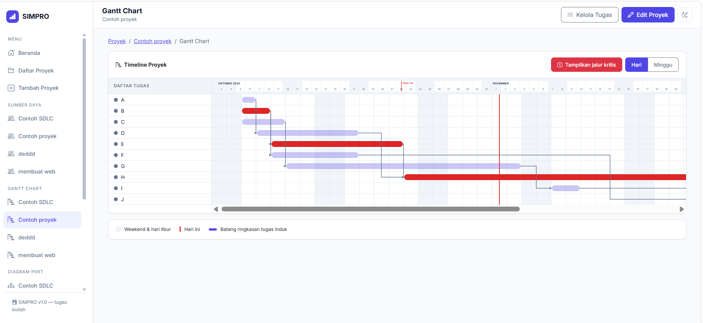
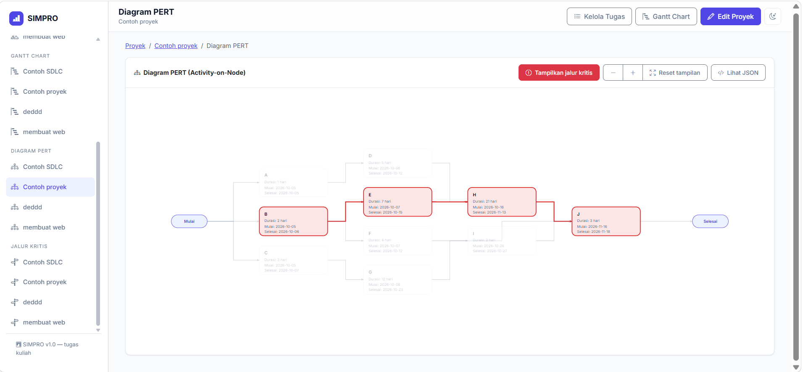
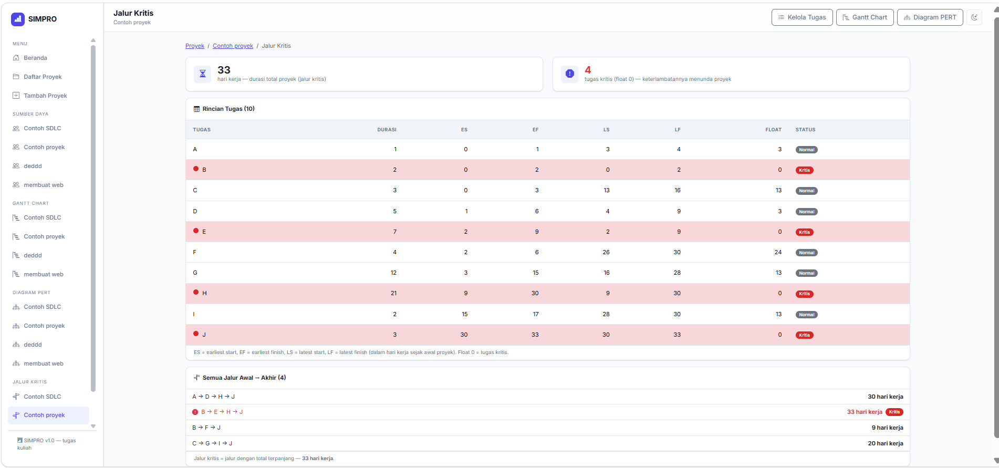

# SIMPRO - Sistem Manajemen Proyek

SIMPRO adalah aplikasi web manajemen proyek sederhana untuk tugas kuliah,
terinspirasi GanttProject. Aplikasi ini memungkinkan kita membuat proyek,
mengatur kalender kerja (weekend dan hari libur), menyusun tugas dan sub-tugas
berjenjang, mendefinisikan dependensi antar tugas, mengalokasikan sumber daya
(anggota tim) beserta cutinya, lalu memvisualisasikannya melalui **Gantt Chart**,
**PERT Chart**, dan **analisis jalur kritis**.

## Daftar Fitur

- **Proyek dan kalender kerja dengan hari libur** — CRUD proyek, pengaturan
  hari weekend (per hari, dengan mode `no_work`/`work`), serta hari libur
  sekali pakai maupun berulang tiap tahun.
- **Tugas dan sub-tugas** — struktur WBS berjenjang (induk → anak), durasi dalam
  hari kerja, prioritas, warna, milestone, progress, dan rollup jadwal otomatis
  ke tugas induk.
- **Dependensi FS/SS/FF/SF dengan delay** — ketergantungan antar tugas dengan
  tipe Finish-to-Start, Start-to-Start, Finish-to-Finish, dan Start-to-Finish,
  lengkap dengan delay (lag) hari kerja; penjadwalan ulang otomatis dan
  penolakan siklus dependensi.
- **Sumber daya dan penugasan dengan cuti** — CRUD anggota tim (kapasitas,
  gaji, data kustom), cuti/sakit berrentang (tanggal mulai–selesai), serta
  alokasi anggota ke tugas.
- **Gantt Chart** — bar jadwal per tugas (termasuk milestone), zoom
  Hari/Minggu/Bulan, mode "Muat layar", dan panah dependensi.
- **PERT Chart** — visualisasi jaringan aktivitas berbentuk SVG.
- **Analisis jalur kritis** — forward/backward pass (ES/EF/LS/LF), total float,
  dan penandaan jalur kritis (jalur terpanjang) di Gantt Chart.

## Teknologi

- **Laravel** — framework PHP (routing, Eloquent ORM, migration, seeder, testing)
- **SQLite** — basis data file-based tanpa server
- **Blade** — templating engine bawaan Laravel
- **Bootstrap 5** — framework CSS via CDN
- **SVG/JavaScript** — rendering Gantt Chart, PERT Chart, dan panah dependensi
  langsung di sisi klien tanpa library eksternal

## Tampilan Aplikasi







## LANGKAH INSTALASI

Pastikan Git, PHP 8.3+, dan Composer terpasang, lalu jalankan berurutan:

```bash
# 1. Salin repositori
git clone <url-repositori> simpro
cd simpro

# 2. Pasang dependensi PHP
composer install

# 3. Siapkan file environment
cp .env.example .env

# 4. Buat application key
php artisan key:generate

# 5. Buat file database kosong
touch database/database.sqlite

# 6. Buat tabel + isi data contoh (2 proyek dari seeder)
php artisan migrate --seed

# 7. Jalankan server pengembangan
php artisan serve
```

Buka `http://127.0.0.1:8000` di browser.

## Cara Memakai Dua Proyek Contoh dari Seeder

Perintah `php artisan migrate --seed` membuat dua proyek contoh yang siap
dipakai langsung:

1. **Contoh SDLC** — proyek mulai Selasa, 30 Juni 2015 (weekend Sabtu–Minggu
   libur, satu hari libur 17 Juli 2015) berisi 6 tugas berantai
   (Analisis Kebutuhan → Analisis Sistem → Perancangan → Implementasi →
   Pengujian → Deployment) dengan campuran dependensi `SS+3`, `SS+5`, dan
   `FS+0`, serta 7 anggota tim (PM, analis, programmer, tester) yang sudah
   ditugaskan ke tugasnya masing-masing.
2. **Contoh Jalur Kritis** — proyek mulai Senin, 5 Oktober 2026 berisi graf
   tugas A–J (semua dependensi `FS` delay 0, total 33 hari kerja) yang
   dirancang untuk mendemonstrasikan analisis jalur kritis (jalur kritis
   B-E-H-J).

Cara memakainya:

1. Dari beranda, klik salah satu proyek contoh.
2. Buka **Kelola Tugas** untuk melihat struktur tugas, jadwal hasil
   penjadwalan dependensi, dan kolom predecessor (mis. `Analisis Kebutuhan (SS+3)`).
3. Buka **Gantt Chart** untuk melihat bar jadwal, panah dependensi, dan
   tombol **Jalur Kritis** yang menandai jalur terpanjang.
4. Buka **PERT Chart** untuk melihat jaringan aktivitas.
5. Buka **Sumber Daya** untuk melihat anggota tim, cuti, dan penugasan
   (khusus proyek Contoh SDLC).
6. Seeding aman dijalankan ulang — bagian yang datanya sudah ada akan
   dilewati tanpa duplikat.

## Cara Menjalankan Tes

```bash
php artisan test
```

Atau per modul, misalnya:

```bash
php artisan test --filter=CalendarServiceTest   # logika kalender kerja
php artisan test --filter=SchedulerServiceTest  # mesin penjadwalan dependensi
php artisan test --filter=PageAccessTest         # smoke test seluruh halaman
```

## Catatan Keputusan Desain

- **Analisis jalur kritis memperlakukan semua dependensi sebagai
  Finish-to-Start.** `CriticalPathService` menghitung ES/EF/LS/LF dan float
  dengan asumsi semua dependensi bertipe FS, dan delay (`lag_days`) tidak
  ikut dihitung — hanya durasi hari kerja tugas. Keputusan ini berlaku
  **khusus** analisis jalur kritis; penjadwalan `SchedulerService` tetap
  membedakan tipe FS/SS/FF/SF beserta delay sesuai aturan GanttProject.
- Penamaan kolom database lama (`predecessor_id`, `successor_id`,
  `lag_days`, `holidays.date`) dipertahankan agar tidak menambah migration
  baru.
- Seluruh perhitungan hari kerja lewat `CalendarService` (libur proyek →
  weekend → mode weekend), sehingga Gantt, PERT, dan jalur kritis satu suara.

## Identitas Pembuat

| | |
| --- | --- |
| **Nama** | Moh Nur Chairul Fikri Mointi |
| **NIM** | `[NIM]` |
| **Mata Kuliah** | `[Mata Kuliah]` |
| **Dosen Pengampu** | `[Dosen Pengampu]` |
